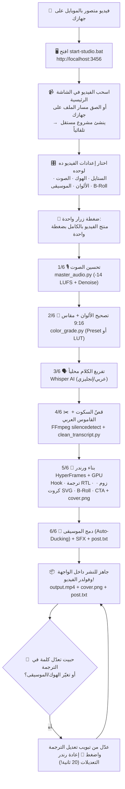

# الفلو الكامل لـ Avesta AI Video Studio v2 (مونتاج كامل بضغطة واحدة) 🎬

الاستوديو ده شغّال **100% محلياً على جهازك ومجاناً بالكامل** — **مفيش نسخ ولصق برومبتات!** بترفع فيديوك من جهازك وتظبّط إعداداته وتضغط زرار واحد، وهو بيعالج كل حاجة لوحده.

---

## 1. مخطط الفلو الأوتوماتيكي (1-Click Autonomous Pipeline)

---

## 2. إزاي ترفع فيديو من جهازك وتعدّل عليه في 3 خطوات فقط؟

### الخطوة 1 — افتح الاستوديو وارفع الفيديو اللوكال
1. اضغط دبل كليك على **`start-studio.bat`** (أو افتح `http://localhost:3456`).
2. في أعلى الشاشة الرئيسية عندك طريقتين لرفع أي فيديو من جهازك:
   - **السحب والإفلات / اختيار ملف:** اضغط **"📂 اختار فيديو من جهازك"** (أو اسحب الفيديو جوه المربع الأصفر).
   - **استيراد فوري للفيديوهات الكبيرة:** اعمل `Shift + كليك يمين` على الفيديو على جهازك → `Copy as path` → الصقه في خانة المسار واضغط **استيراد** (بينسخه في أقل من ثانية!).
3. الاستوديو هيعمل فولدر مستقل للفيديو فوراً ويفتحلك شاشة الإعدادات ومعاينة الموبايل `9:16`.

### الخطوة 2 — ظبّط إعدادات الفيديو (لو حابب تغيّر عن الافتراضي)
* **🎨 الهوك والستايل:** اختار `fast_hook` (سريع وحماسي) أو `educational` (تعليمي) أو `storytelling` (سينمائي)، واكتب عنوان الـ **Hook** (أو سيبه فاضي والاستوديو يطلعه من كلامك أوتوماتيك).
* **🎙️ الصوت والموسيقى:** اختار درجة إزالة الضوضاء (`light`/`medium`/`strong`)، واختار تراك موسيقى خلفية مع تفعيل **Auto-Ducking** والمؤثرات الصوتية.
* **🌈 الألوان وWhisper:** اختار شكل الألوان (`natural`/`warm_creator`/`crisp_edu`/`cinematic` أو `.cube` LUT)، وموديل `Whisper` (`small` سريع أو `medium` أدق للعامية المصرية).
* **📁 الفيديو وB-Roll:** *(اختياري)* اسحب أي صور أو سكرين شوتس عايزها تظهر وسط الفيديو وهتتركّب أوتوماتيك.

### الخطوة 3 — اضغط **"🚀 منتج الفيديو بالكامل بضغطة واحدة"**
* تابع شريط التقدم المباشر للـ **6 مراحل** لحد ما يوصل **100%**.
* أول ما يخلص، تقدر:
  - تقارن **قبل وبعد** جوه إطار الموبايل (`النهائي output` ⇄ `بعد الألوان` ⇄ `الأصلي input`).
  - تحمّل **`output.mp4`** و**`cover.png`** وتنسخ **`post.txt`** من تبويب **📦 النتائج النهائية**.

---

## 3. إزاي تعدّل أي كلمة أو تفصيلة بعد المونتاج في 20 ثانية؟
لو Whisper غلط في كلمة أو حبيت تغيّر الهوك أو لون الكلمة المميّزة أو مستوى الموسيقى:
1. افتح تبويب **📝 تعديل الترجمة** جوه نفس الفيديو.
2. عدّل أي سطر نص أو اكتب الكلمة اللي عايزها تتلوّن بلون الهوية.
3. اضغط **🔄 حفظ وإعادة رندر سريع** — المحرك بيتخطى تفريغ Whisper وقصّ السكوت ويعيد رندر الفيديو والغلاف بس في ~20 ثانية!
4. *(ونصيحة)* أي كلمة غلطت فيها Whisper ضيفها مرة واحدة في **📖 قاموس التصحيح** جوه تبويب **🎨 الهوية البصرية والثيم** عشان تتصحح أوتوماتيك في كل فيديوهاتك الجاية.
